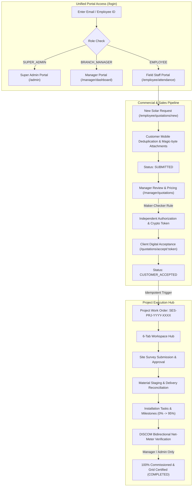

# ☀️ SHIVAY ENERGY SOLUTIONS
> **Tagline:** Save Green Energy To Build A Better Future  
> **Headquarters:** Ward No. 15, In front of PHE Office, Arjun Nagar, Raisen, Madhya Pradesh – 464551, India  
> **Executive Leadership:** Deepak Kushwaha (Managing Director & Founder) | Rahul Saini (Operations & Customer Support Head)  
> **Official Email:** shivayenergysolutions@gmail.com  
> **DISCOM Area:** MPPKVVCL (Madhya Kshetra Vidyut Vitaran Co. Ltd) & Central India  

---

## 📑 Table of Contents
1. [Platform Overview](#-platform-overview)
2. [Shivay Energy Management System (Admin & Operations Portal)](#-shivay-energy-management-system-admin--operations-portal)
   - [Unified Authentication & RBAC Hierarchy](#1-unified-authentication--rbac-hierarchy)
   - [Commercial Engine & Quotation Lifecycle](#2-commercial-engine--quotation-lifecycle)
   - [Project Execution Hub (6-Tab Workspace)](#3-project-execution-hub-6-tab-workspace)
   - [Field Staff GPS Attendance & Geofencing](#4-field-staff-gps-attendance--geofencing)
   - [Cloudinary Secure Document Architecture](#5-cloudinary-secure-document-architecture)
   - [System Security Audit & Activity Logs](#6-system-security-audit--activity-logs)
3. [Material Management & Stock Inventory System (Phase 1 & Phase 2)](#-material-management--stock-inventory-system)
   - [Material Master & SKU Control](#material-master--sku-control)
   - [Supplier & Vendor Registry](#supplier--vendor-registry)
   - [Purchase Orders & WAC Valuation](#purchase-orders--wac-valuation)
   - [Independent Material Sales & Billing](#independent-material-sales--billing)
   - [Dispatch Management & Transport Tracking](#dispatch-management--transport-tracking)
   - [Returns & Quarantine RMA Handling](#returns--quarantine-rma-handling)
   - [Stock Movement Ledger & CSV Exports](#stock-movement-ledger--csv-exports)
4. [Dynamic Website CMS & Content Management](#-dynamic-website-cms--content-management)
   - [Services Master](#services-master)
   - [Products & Inverters](#products--inverters)
   - [Recent Projects Showcase](#recent-projects-showcase)
   - [Founders & Team Profiles](#founders--team-profiles)
   - [Customer Testimonials](#customer-testimonials)
   - [Live Company Profile & Contact Info Sync](#live-company-profile--contact-info-sync)
5. [Website Enquiries & Lead Pipeline](#-website-enquiries--lead-pipeline)
   - [Free Solar Site Survey Bookings](#free-solar-site-survey-bookings)
   - [Franchise / Dealer Applications](#franchise--dealer-applications)
   - [Customer Grievance & Complaint Tracking](#customer-grievance--complaint-tracking)
6. [System Settings & Global Policies](#-system-settings--global-policies)
7. [Public Website & Consumer Portals](#-public-website--consumer-portals)
8. [End-to-End Workflow Diagram](#-end-to-end-workflow-diagram)
9. [Complete Route & Endpoint Directory](#-complete-route--endpoint-directory)
10. [Architecture & Directory Structure](#-architecture--directory-structure)
11. [Environment Variables Configuration (Template)](#-environment-variables-configuration-template)
12. [Automated Verification & Test Suite (100% Pass)](#-automated-verification--test-suite-100-pass)
13. [Running the Application](#-running-the-application)

---

## ⚡ Platform Overview
The **Shivay Energy Solutions Platform** is a full-stack, enterprise-grade Solar Energy Management and Consumer Web System built for rooftop, agricultural (PM-KUSUM), and commercial/industrial solar EPC operations across Madhya Pradesh.

The system seamlessly combines:
1. **Dynamic Public Consumer Web Portal**:
   - Official Central Govt PM Surya Ghar Muft Bijli Yojana awareness and subsidy calculator (up to ₹78,000/- Direct DBT).
   - Dynamic service catalog, recent projects gallery (strictly 3 featured projects on home page), products, team, and testimonials.
   - Lead capture engines: Free Solar Site Survey Bookings and Franchise / Dealer Application forms.
   - Real-time customer complaint filing and case-insensitive ticket tracking (`SHIVAY-XXXXX`).
2. **Enterprise Management System (SEMS)**:
   - Single portal entry (`/login`) with role-based routing (Super Admin, Branch Manager, Field Staff).
   - Commercial Quotation drafting with Maker-Checker segregation of duties, automated GST splits, and client digital acceptance tokens.
   - 6-Tab Project Lifecycle Hub with magic-byte verified engineering documents.
   - Geo-tagged field technician attendance engine.
   - Comprehensive Material Management & Stock Inventory System (Phase 1 & Phase 2).
   - Super Admin Dynamic Website CMS with real-time company profile synchronization.
   - Complete system settings (pricing, subsidies, geofencing, net-metering).

---

## 🛡️ Shivay Energy Management System (Admin & Operations Portal)



### 1. Unified Authentication & RBAC Hierarchy
- **Single Portal Entry:** All staff roles (Super Admin, Branch Manager, Field Engineer) authenticate through `/login` (with aliases `/admin/login`, `/manager/login`, `/employee/login`).
- **No Public Registration:** Staff accounts are provisioned exclusively by Super Admins through `/admin/employees`.
- **Role Isolation & Boundaries:**
  - **Super Admin (`SUPER_ADMIN`)**: Complete cross-branch oversight, staff onboarding, branch administration, Dynamic Website CMS, Material Inventory, Settings, and immutable audit logs (`/admin/activity-logs`).
  - **Branch Manager (`BRANCH_MANAGER` / `MANAGER`)**: Branch-scoped project management, quotation review, survey approval, and final commissioning certification (`COMPLETED`).
  - **Field Employee (`EMPLOYEE`)**: Geo-tagged attendance check-in, quotation drafting, survey submission, and milestone progression (`SITE_VISIT_PENDING` to `DISCOM_DOCUMENTATION`).
  - **Security Gate:** Field employees are strictly blocked with **HTTP 403 Forbidden** if they attempt to self-approve quotations or mark projects `COMPLETED`.
- **Smart Login Redirection:**
  - `SUPER_ADMIN` ➔ Redirects to `/admin`
  - `BRANCH_MANAGER` ➔ Redirects to `/manager/dashboard`
  - `EMPLOYEE` ➔ Automatically lands directly on `/employee/attendance` for immediate GPS check-in.

---

### 2. Commercial Engine & Quotation Lifecycle
- **Lead Capture & Mobile Deduplication:** Field agents query customer phone numbers (`/api/customers/search?mobile=...`) to auto-fill existing customer records.
- **Financial & Sizing Engine:**
  - Automated DC capacity sizing based on roof area and sanction load.
  - GST calculations (12% solar supply or 70:30 EPC deemed civil supply).
  - Central Government Subsidy Deduction (PM Surya Ghar): ₹30,000 for 1 kW, ₹60,000 for 2 kW, and ₹78,000 for 3 kW and above.
  - Payment Milestones: 20% Advance, 60% Material delivery at site, 20% Post DISCOM testing & commissioning.
- **Maker-Checker Segregation of Duties:** The staff member who prepares a quotation cannot authorize or approve it. Independent Manager or Super Admin sign-off is mandatory.
- **Client Digital Acceptance & Proposal Sharing:**
  - Cryptographically unguessable token (`535ba11...`) generated on approval.
  - Public acceptance portal (`/quotations/accept/:token`) allows clients to review specifications and accept digitally.
  - Official proposal sharing via WhatsApp with instant PDF letterhead generation.

---

### 3. Project Execution Hub (6-Tab Workspace)
- **Automatic Provisioning:** Quotations marked `CUSTOMER_ACCEPTED` automatically instantiate a new Project Work Order (`SES-PRJ-YYYY-XXXX`).
- **Quick Status Modal:** Project status can be updated directly from the projects table (`/admin/projects`, `/manager/projects`, `/employee/projects`) using the pencil icon without leaving the page.
- **6-Tab Workspace Hub (`/projects/:id`):**
  1. **Overview & Specs:** System capacity, equipment models, customer coordinates, and contract terms.
  2. **Site Survey:** Roof dimensions, tilt angle, shadow analysis, sanction load feasibility, and manager clearance badge.
  3. **Tasks:** Work breakdown structure with assignees, priority tags, and completion timestamps.
  4. **Bill of Materials (BOM):** Modules, inverters, elevated structures, DC/AC distribution boxes with delivery reconciliation.
  5. **Documents:** SLD engineering drawings, site photos, DISCOM feasibility letters with magic-byte validation and Cloudinary CDN links.
  6. **Activity History:** Tamper-evident chronological audit timeline capturing every milestone and status shift.
- **Final Grid Commissioning Gate:**
  `COMPLETED` (100%) status can **only** be certified by Branch Managers or Super Admins and strictly requires the government DISCOM bidirectional net-meter serial number (`meterNumber`).

---

### 4. Field Staff GPS Attendance & Geofencing
- **Geo-Tagged Check In/Out:** Field technicians log attendance from `/employee/attendance` with device GPS coordinates and accuracy radius.
- **Anti-Spoofing Identity Lock:** Attendance identity is derived strictly from the verified HTTP session (`req.session.user`). Altering employee IDs in request bodies is rejected.
- **Branch Geofencing:** Validates coordinates against the assigned branch office location using Haversine distance calculations.

---

### 5. Cloudinary Secure Document Architecture
- **Dedicated Cloud Storage:** All documents and media are stored securely under the dedicated **`shivay_energy`** Cloudinary folder.
- **Magic-Byte MIME Inspection:** Pre-upload inspection verifies file signatures (JPEG: `FF D8 FF`, PNG: `89 50 4E 47`, PDF: `%PDF`, WEBP: `RIFF...WEBP`). Disguised executables (.exe, .sh renamed to .jpg) are rejected immediately.
- **Cloud-Native Streaming:** Files are streamed directly to Cloudinary without writing temporary files to local disk.

---

### 6. System Security Audit & Activity Logs
Accessible at `/admin/activity-logs`:
- **Real-Time Security Logging:** Records authentication events, failed logins, unauthorized access attempts, quotation approvals, stock adjustments, and project milestones.
- **Metric KPI Cards:** Total Events, Security Alerts, Auth Events, and Commercial Mutations.
- **Responsive Architecture:** Desktop table and SaaS-style mobile card stack with zero horizontal overflow.
- **Search & Category Filters:** Live typing search across actor, action, IP, and details payload with one-click category pills (`All`, `Security`, `Auth`, `Commercial`, `Field`).
- **JSON Payload Inspector:** Interactive modal with syntax highlighting and copy-to-clipboard shortcut.

---

## 📦 Material Management & Stock Inventory System

A comprehensive, standalone business module inside the Super Admin panel supporting both general business inventory and solar project allocations.

```
Material Management
├── Material List (/admin/materials)
├── Stock Inventory (/admin/inventory)
├── Purchase / Stock In (/admin/purchases)
├── Sales / Stock Out (/admin/sales-out)
├── Dispatch Management (/admin/dispatch)
├── Returns (/admin/returns)
├── Suppliers (/admin/suppliers)
└── Stock Reports (/admin/inventory/reports)
```

### Material Master & SKU Control
- Complete catalog management (`/admin/materials`) with auto-generated unique SKUs (`MAT-0001` or custom).
- Fields: Name, SKU, Category, Brand, Model, Technical Specs, Description, UOM, Minimum Stock Threshold, Default Selling Price, and Active/Inactive status.
- Duplicate SKU insertion is strictly blocked.

### Supplier & Vendor Registry
- Supplier directory (`/admin/suppliers`) capturing Company Name, Contact Person, Mobile, Email, GSTIN, Address, and Notes.
- Status toggle allows activating or deactivating vendors without deleting historical records.

### Purchase Orders & WAC Valuation
- Draft purchase creation (`/admin/purchases/new`) with multi-item line pricing, GST rates, and landed cost allocation (freight, packaging, transit insurance).
- Stock levels remain unchanged while orders are in `DRAFT` status.
- **Weighted Average Cost (WAC) Blending:** Confirming receipt (`RECEIVED`) increments stock and blends unit cost:
  $$\text{New WAC} = \frac{(\text{Existing Stock} \times \text{Current WAC}) + (\text{Received Qty} \times \text{Landed Cost})}{\text{New Total Stock}}$$
- Idempotency guard prevents double-confirmation (HTTP 400/409).

### Independent Material Sales & Billing
- Independent sales orders (`/admin/sales-out/new`) supporting contractors, walk-in customers, or CRM clients without requiring an active solar project.
- Server-side price calculation: Frontend prices and totals are never trusted.
- Sells only active materials; insufficient stock or zero/negative quantities are blocked with HTTP 400.
- Custom Selling Price Override Audit: Selling below WAC requires explicit reason logging.
- Deducts inventory exactly once upon order confirmation.
- Printable GST-compliant Sales Invoice (`/admin/sales/:id/invoice`).

### Dispatch Management & Transport Tracking
- Independent dispatch records (`/admin/dispatch/new`) capturing Courier/Transport Name, Vehicle Number, Tracking/LR Number, Driver Mobile, and Destination.
- Tracks pending vs dispatched quantities. Dispatches do not deduct inventory again (already deducted at sale).

### Returns & Quarantine RMA Handling
- Customer return requests (`/admin/returns/new`) validate against eligible sold quantities.
- **Condition GOOD:** Restocks sellable inventory and logs positive movement.
- **Condition DAMAGED / DEFECTIVE:** Quarantined into damaged stock ledger; sellable stock remains untouched.
- **Condition PENDING_INSPECTION:** Held in inspection quarantine.
- Re-approval protection (HTTP 409) prevents double-restocking.

### Stock Movement Ledger & CSV Exports
- Controlled Super Admin stock adjustments (ADD/REMOVE) with mandatory reason logging and strict negative stock prohibition.
- Exportable RFC-compliant CSVs:
  - Current Stock Valuation CSV (`/admin/inventory/export-stock`)
  - Movement Ledger CSV (`/admin/inventory/export-transactions`)
  - Sales Orders CSV (`/admin/sales/export-csv`)

---

## 🌐 Dynamic Website CMS & Content Management

Located directly above Settings in the Super Admin sidebar, the Website Management suite allows live editing of public website content with zero downtime:

- **Services Master (`/admin/website/services`):** Full CRUD for solar and EV services with Cloudinary image upload, highlights, and active/inactive toggle.
- **Products & Inverters (`/admin/website/products`):** High-efficiency on-grid, hybrid, and off-grid inverter specs, capacity ranges, and pricing.
- **Recent Projects (`/admin/website/projects`):** Project portfolio management (strictly 3 featured on home page, full catalog on `/projects`).
- **Founders & Team (`/admin/website/team`):** Leadership profiles (Deepak Kushwaha, Rahul Saini) with bios and social links.
- **Customer Testimonials (`/admin/website/testimonials`):** Verified client reviews, ratings, and customer locations.
- **Company Profile & Contact Info Sync (`/admin/website/contact`):** Real-time synchronization: updating phone numbers, address, email, or working hours instantly updates the public header, navbar, footer, and contact page.
- **Functional Actions:** Every card includes **Edit** and **Delete** buttons with modal dialogs and AJAX handling.

---

## 📩 Website Enquiries & Lead Pipeline

Grouped under **Website Enquiries** in the Super Admin sidebar:

- **Free Solar Site Surveys (`/admin/enquiries/surveys`):**
  - Public booking form capturing name, mobile, district, roof type, and monthly electricity bill.
  - Admin management: status transitions (`NEW`, `CONTACTED`, `SURVEY_SCHEDULED`, `COMPLETED`, `REJECTED`), internal notes, search, and deletion.
- **Franchise / Dealer Applications (`/admin/enquiries/franchise`):**
  - Public dealer application capturing business name, experience, investment capacity, and premises details.
  - Admin review pipeline, candidate status updates, and notes.
- **Customer Complaints Console (`/admin/complaints`):**
  - Public ticket registration and case-insensitive tracking by Ticket ID (`SHIVAY-XXXXX`) and 10-digit mobile number.
  - Admin status updates (`registered` ➔ `assigned` ➔ `in_progress` ➔ `resolved`) with technician notes.

---

## ⚙️ System Settings & Global Policies

Accessible at `/admin/settings`:
- **Pricing & Subsidies:** System base pricing per watt and PM Surya Ghar central subsidy slabs.
- **GPS Geofencing:** Branch geofence radius and coordinate verification thresholds.
- **Security & Policies:** Session timeouts, lockout thresholds, and Maker-Checker enforcement.
- **DISCOM Net-Metering:** Electricity board sanction guidelines and CEIG documentation rules.
- **Privacy Policy & Terms Editor (One-Paste Update):** Super Admin can update the public Privacy Policy and Terms & Conditions directly in one paste. Includes "Paste from Clipboard", "Load Default Policy/T&C", and "Clear" tools with instant public site synchronization.
- **Fallback Data Removal:** All dummy quotation, attendance, and enquiry fallback objects have been cleanly removed from the data store.

---

## 💻 Public Website & Consumer Portals

- **Homepage (`/`):** Dynamic showcase of residential, commercial, and agricultural solar rooftop systems with strictly 3 featured recent projects.
- **PM Surya Ghar Subsidy Guide (`/#govt-scheme-section`):** Comprehensive breakdown of central DBT subsidies up to ₹78,000/- (1 kW: ₹30,000, 2 kW: ₹60,000, 3 kW+: ₹78,000). State subsidy column removed per official regulations.
- **Privacy Policy (`/privacy-policy`):** Detailed, personalized data protection and transparency policy covering site surveys, PM Surya Ghar KYC, customer complaints, and dealership forms.
- **Terms & Conditions (`/terms-and-conditions`):** Comprehensive turnkey solar EPC agreement covering feasibility, 20/60/20 payment milestones, warranties, and MPPKVVCL net-metering.
- **Interactive Solar Savings Calculator (`/calculator`):** Computes recommended plant capacity (kW), monthly unit generation, annual savings in ₹, central subsidy deductions, and estimated payback period.
- **Customer Grievance & Complaint Tracker (`/complaints`):** Online ticket registration and case-insensitive tracking by Ticket ID (`SHIVAY-XXXXX`) and mobile number.
- **Dealership & Franchise Portal (`/franchise`):** District-wise dealership application across Madhya Pradesh.
- **Services Catalog (`/services`):** Dynamic listing of all 8 core solar and EV services.
- **Projects Showcase (`/projects`):** Dynamic portfolio of all 8 completed solar rooftop, industrial, and agricultural installations.
- **Products Catalog (`/products`):** Dynamic catalog of Tier-1 panels, inverters, batteries, and EV chargers.

---

## 🌐 End-to-End Workflow Diagram

| Step | Stage | Primary Role | Action / Milestone | Resulting Status |
|:---:|:---|:---|:---|:---|
| **1** | Staff Onboarding | Super Admin | Creates staff profile via `/admin/employees` | User record created (`SES-EMP-XX`) |
| **2** | Daily Sign In | Field Engineer | Logs in at `/login` ➔ Lands on `/employee/attendance` | Geo-tagged check-in recorded |
| **3** | Lead Capture | Field Engineer | Enters customer profile & solar specs at `/employee/quotations/new` | Request created (`SUBMITTED`) |
| **4** | Technical Review | Branch Manager | Inspects specs, applies discounts & checks feasibility at `/manager/quotations` | Quotation authorized (`APPROVED`) |
| **5** | Customer Acceptance | Client / Manager | Accepts proposal via `/quotations/accept/:token` or direct confirmation | Quotation marked (`CUSTOMER_ACCEPTED`) |
| **6** | Work Order Creation | Automation Engine | Idempotently provisions Project Work Order | Project created (`SES-PRJ-YYYY-XXXX`) |
| **7** | Material Allocation | Super Admin | Creates sale or purchase order via Material Management | Stock allocated & WAC blended |
| **8** | Site Survey | Field Engineer | Submits roof dimensions, tilt angle & photos to Cloudinary | Survey status: `SUBMITTED` |
| **9** | Survey Clearance | Branch Manager | Approves survey observations in workspace | Project advances to 25% |
| **10** | Material Delivery | Field Team | Stages & marks delivery of panels, inverter, mounting kits | Status: `MATERIAL_READY` (55%) |
| **11** | Physical Installation | Field Engineers | Executes electrical BoS, earthing, module stringing & DCDB wiring | Status: `INSTALLATION_IN_PROGRESS` (70%) |
| **12** | DISCOM Liaisoning | Manager / Staff | Submits Net-Metering application to MPPKVVCL | Status: `DISCOM_DOCUMENTATION` (95%) |
| **13** | Grid Commissioning | Branch Manager | Inspects bidirectional net-meter & certifies completion | **`COMPLETED` (100% Certified)** |

---

## 🗺️ Complete Route & Endpoint Directory

### Authentication & Sessions
| Method | Route | Access | Description |
|:---|:---|:---|:---|
| `GET` | `/login` | Public | Single portal entry (aliases: `/admin/login`, `/manager/login`, `/employee/login`) |
| `POST` | `/login` | Public | Authenticates credentials, initiates session & routes based on role |
| `POST` | `/logout` | Authenticated | Clears session, invalidates cookies & redirects to `/login` |

### Super Admin Portal (`/admin`)
| Method | Route | Access | Description |
|:---|:---|:---|:---|
| `GET` | `/admin` | Super Admin | Executive Dashboard with system KPIs, revenue & project status |
| `GET` | `/admin/projects` | Super Admin | All projects across branches with Quick Status modal |
| `GET` | `/admin/quotations` | Super Admin | Cross-branch quotation registry & Maker-Checker authorization |
| `GET` | `/admin/customers` | Super Admin | Central CRM customer directory with mobile search |
| `GET` | `/admin/invoices` | Super Admin | Tax invoices repository |
| `GET` | `/admin/reports` | Super Admin | Executive reports & analytical summaries |
| `GET` | `/admin/employees` | Super Admin | Staff directory, role configuration & onboarding |
| `GET` | `/admin/managers` | Super Admin | Branch Manager administration |
| `GET` | `/admin/branches` | Super Admin | Office branch locations, geofence radius & branch codes |
| `GET` | `/admin/activity-logs`| Super Admin | Tamper-evident system audit trail with search & JSON inspector |
| `GET` | `/admin/settings` | Super Admin | System configuration (Pricing, Subsidies, Geofencing, Net-Metering) |
| `POST`| `/admin/settings/save`| Super Admin | Persists global system settings |

### Material Management & Inventory (`/admin`)
| Method | Route | Access | Description |
|:---|:---|:---|:---|
| `GET` | `/admin/materials` | Super Admin | Material Master catalog |
| `POST`| `/admin/materials` | Super Admin | Creates new material with unique SKU |
| `POST`| `/admin/materials/:id/edit` | Super Admin | Updates material specs and pricing |
| `POST`| `/admin/materials/:id/status` | Super Admin | Toggles active/inactive status |
| `GET` | `/admin/inventory` | Super Admin | Stock inventory dashboard |
| `POST`| `/admin/inventory/adjust` | Super Admin | Controlled stock adjustment (ADD/REMOVE) |
| `GET` | `/admin/inventory/reports` | Super Admin | Stock valuation & transaction reports |
| `GET` | `/admin/inventory/export-stock` | Super Admin | Exports on-hand stock CSV |
| `GET` | `/admin/inventory/export-transactions` | Super Admin | Exports stock transaction ledger CSV |
| `GET` | `/admin/purchases` | Super Admin | Purchase orders / stock in listing |
| `POST`| `/admin/purchases` | Super Admin | Creates draft purchase order |
| `GET` | `/admin/purchases/:id` | Super Admin | Purchase order detail view |
| `POST`| `/admin/purchases/:id/receive` | Super Admin | Confirms purchase, increments stock & blends WAC |
| `GET` | `/admin/sales-out` | Super Admin | Material sales orders listing |
| `POST`| `/admin/sales-out` | Super Admin | Creates draft material sale |
| `GET` | `/admin/sales/:id` | Super Admin | Sale order detail view |
| `POST`| `/admin/sales/:id/confirm` | Super Admin | Confirms sale & deducts stock |
| `GET` | `/admin/sales/:id/invoice` | Super Admin | Printable GST sales invoice |
| `POST`| `/admin/sales/:id/cancel` | Super Admin | Cancels sale & reverses stock |
| `GET` | `/admin/sales/export-csv` | Super Admin | Exports sales ledger CSV |
| `GET` | `/admin/dispatch` | Super Admin | Dispatch orders listing |
| `POST`| `/admin/dispatch` | Super Admin | Creates dispatch order |
| `GET` | `/admin/dispatch/:id` | Super Admin | Dispatch detail view |
| `GET` | `/admin/returns` | Super Admin | Material returns listing |
| `POST`| `/admin/returns` | Super Admin | Creates return request (RMA) |
| `GET` | `/admin/returns/:id` | Super Admin | Return detail view |
| `POST`| `/admin/returns/:id/approve` | Super Admin | Approves return & routes to sellable/damaged stock |
| `GET` | `/admin/suppliers` | Super Admin | Supplier / vendor registry |
| `POST`| `/admin/suppliers` | Super Admin | Registers new supplier |
| `POST`| `/admin/suppliers/:id/toggle` | Super Admin | Toggles supplier active status |

### Dynamic Website CMS (`/admin/website`)
| Method | Route | Access | Description |
|:---|:---|:---|:---|
| `GET` | `/admin/website/services` | Super Admin | Services CMS with Edit/Delete buttons & modal |
| `POST`| `/admin/website/services` | Super Admin | Creates new service with Cloudinary image |
| `POST`| `/admin/website/services/:id` | Super Admin | Updates service details |
| `POST`| `/admin/website/services/:id/delete` | Super Admin | Deletes service |
| `GET` | `/admin/website/products` | Super Admin | Products CMS with Edit/Delete buttons & modal |
| `POST`| `/admin/website/products` | Super Admin | Creates new product |
| `POST`| `/admin/website/products/:id` | Super Admin | Updates product details |
| `POST`| `/admin/website/products/:id/delete` | Super Admin | Deletes product |
| `GET` | `/admin/website/projects` | Super Admin | Recent Projects CMS with Edit/Delete buttons |
| `POST`| `/admin/website/projects` | Super Admin | Creates new project card |
| `POST`| `/admin/website/projects/:id` | Super Admin | Updates project card |
| `POST`| `/admin/website/projects/:id/delete` | Super Admin | Deletes project card |
| `GET` | `/admin/website/team` | Super Admin | Founders & Team CMS |
| `POST`| `/admin/website/team` | Super Admin | Adds new team member |
| `POST`| `/admin/website/team/:id` | Super Admin | Updates team member |
| `POST`| `/admin/website/team/:id/delete` | Super Admin | Deletes team member |
| `GET` | `/admin/website/testimonials` | Super Admin | Customer Testimonials CMS |
| `POST`| `/admin/website/testimonials` | Super Admin | Adds customer testimonial |
| `POST`| `/admin/website/testimonials/:id` | Super Admin | Updates testimonial |
| `POST`| `/admin/website/testimonials/:id/delete` | Super Admin | Deletes testimonial |
| `GET` | `/admin/website/contact` | Super Admin | Company Profile & Contact Info editor |
| `POST`| `/admin/website/contact` | Super Admin | Updates company contact info with live sync |

### Website Enquiries (`/admin/enquiries`)
| Method | Route | Access | Description |
|:---|:---|:---|:---|
| `GET` | `/admin/enquiries/surveys` | Super Admin | Free Solar Site Surveys lead console |
| `POST`| `/admin/enquiries/surveys/:id/status` | Super Admin | Updates survey lead status & notes |
| `POST`| `/admin/enquiries/surveys/:id/delete` | Super Admin | Deletes survey enquiry |
| `GET` | `/admin/enquiries/franchise` | Super Admin | Franchise / Dealer applications console |
| `POST`| `/admin/enquiries/franchise/:id/status`| Super Admin | Updates franchise application status |
| `POST`| `/admin/enquiries/franchise/:id/delete`| Super Admin | Deletes franchise application |
| `GET` | `/admin/complaints` | Super Admin | Customer complaints resolution console |
| `POST`| `/admin/complaints/:id/status` | Super Admin | Updates complaint status & resolution notes |

### Branch Manager Portal (`/manager`)
| Method | Route | Access | Description |
|:---|:---|:---|:---|
| `GET` | `/manager/dashboard` | Manager | Branch-scoped KPIs, active work orders & attendance logs |
| `GET` | `/manager/projects` | Manager | Branch project listing with Quick Status modal |
| `GET` | `/manager/quotations`| Manager | Branch quotation requests & Maker-Checker authorization |
| `GET` | `/manager/employees` | Manager | Branch staff list & daily attendance view |
| `GET` | `/manager/attendance`| Manager | Branch employee GPS check-in logs |

### Field Employee Portal (`/employee`)
| Method | Route | Access | Description |
|:---|:---|:---|:---|
| `GET` | `/employee/attendance` | Employee | Daily GPS-geofenced attendance punch interface |
| `POST`| `/employee/attendance/punch-in` | Employee | Records session-verified GPS check-in |
| `POST`| `/employee/attendance/punch-out` | Employee | Records check-out timestamp |
| `GET` | `/employee/projects` | Employee | Assigned projects list with Quick Status modal |
| `GET` | `/employee/quotations` | Employee | Personal drafted quotations |
| `GET` | `/employee/quotations/new` | Employee | New solar request intake form |

### Public Consumer Website
| Method | Route | Access | Description |
|:---|:---|:---|:---|
| `GET` | `/` | Public | Dynamic home page with Central DBT PM Surya Ghar subsidy guide |
| `GET` | `/about` | Public | About Us page with Founder & Executive Leadership showcase |
| `GET` | `/services` | Public | Dynamic Solar & Clean Energy Services Catalog |
| `GET` | `/products` | Public | Dynamic Tier-1 Panels, Inverters & EV Chargers Catalog |
| `GET` | `/projects` | Public | Dynamic Completed Projects Gallery & Rooftop Showcase |
| `GET` | `/calculator` | Public | Interactive Solar Savings & Capacity Calculator |
| `GET` | `/contact` | Public | Contact Us page with live company coordinates & enquiry form |
| `POST`| `/api/enquiries/survey` | Public | Free Solar Site Survey application submission |
| `GET` | `/franchise` | Public | Franchise / Dealership application page |
| `POST`| `/franchise` | Public | Franchise / Dealership application submission |
| `GET` | `/complaints` | Public | Customer Grievance Registration & Ticket Tracking |
| `POST`| `/complaints` | Public | Customer complaint registration |
| `GET` | `/complaints/track` | Public | Case-insensitive complaint status check |
| `GET` | `/privacy-policy` | Public | Personalized Privacy Policy & Form Data Disclosure (aliases: `/privacy`, `/privacy.html`) |
| `GET` | `/terms-and-conditions` | Public | Complete Solar EPC Terms & Conditions (aliases: `/terms`, `/terms.html`) |

---

## 🏗️ Architecture & Directory Structure

```
c:\rid\solar_panial\
├── config/
│   ├── cloudinary.js          # Cloudinary configuration (shivay_energy folder)
│   ├── company.js             # Master corporate identity & baseline catalog
│   └── database.js            # MongoDB connection & connection event handling
├── controllers/
│   ├── adminController.js     # Super admin dashboard & staff management
│   ├── authController.js      # Single-portal login, session & logout
│   ├── complaintController.js # Complaint registration & tracking
│   ├── customerController.js  # CRM customer search & deduplication
│   ├── employeeController.js  # Field employee attendance & quotation drafting
│   ├── enquiryController.js   # Solar site survey & franchise applications
│   ├── franchiseController.js # Public franchise submission handler
│   ├── managerController.js   # Branch manager project & quotation review
│   ├── materialController.js  # Phase 1: Material Master, Suppliers, Purchases, Stock
│   ├── materialPhase2Controller.js # Phase 2: Sales, Dispatches, Returns RMA
│   ├── pageController.js      # Public website pages & dynamic site data
│   ├── projectController.js   # 6-Tab project workspace & status lifecycle
│   ├── quotationController.js # Commercial quotations & Maker-Checker rules
│   └── websiteCmsController.js# Dynamic Website CMS CRUD controllers
├── middleware/
│   ├── authMiddleware.js      # Session auth, role hierarchy & CSRF verification
│   └── rateLimiters.js        # IP brute-force protection
├── models/
│   ├── Attendance.js          # GPS-tagged field employee attendance
│   ├── AuditLog.js            # Immutable system audit trail
│   ├── Branch.js              # Multi-branch offices & geofence coordinates
│   ├── Complaint.js           # Customer grievance tickets
│   ├── Customer.js            # CRM client directory
│   ├── Enquiry.js             # Free solar site survey enquiries
│   ├── FranchiseApplication.js# Dealership / franchise applications
│   ├── InventoryTransaction.js# Stock movement ledger
│   ├── Invoice.js             # Tax invoices
│   ├── Material.js            # Material Master records & SKU index
│   ├── MaterialDispatch.js    # Dispatch orders & tracking
│   ├── MaterialReturn.js      # RMA return requests
│   ├── MaterialSale.js        # Standalone material sales orders
│   ├── Project.js             # 6-Tab project work orders
│   ├── Purchase.js            # Purchase orders & stock-in records
│   ├── Quotation.js           # Authorized commercial quotations
│   ├── QuotationRequest.js    # Drafted quotation proposals
│   ├── Setting.js             # Global system settings & dynamic company profile
│   ├── Supplier.js            # Registered vendor records
│   ├── User.js                # System staff accounts & RBAC roles
│   ├── WebProduct.js          # Dynamic CMS products
│   ├── WebProject.js          # Dynamic CMS recent projects
│   ├── WebService.js          # Dynamic CMS services
│   ├── WebTeam.js             # Dynamic CMS leadership & staff
│   └── WebTestimonial.js      # Dynamic CMS customer reviews
├── public/
│   ├── css/
│   │   ├── admin.css          # Admin panel design system & compact sidebar styles
│   │   ├── govt-scheme.css    # PM Surya Ghar subsidy section styling
│   │   └── style.css          # Public consumer site styles
│   ├── js/                    # Client calculators, 3D project stack, dynamic UI
│   └── images/                # Static assets & brand logos
├── routes/
│   ├── privateroute/
│   │   ├── authroutes.js      # Unified login & logout
│   │   ├── employeeroutes.js  # Employee attendance & projects
│   │   ├── managerroutes.js   # Manager review & dashboard
│   │   └── superadminroutes.js# Super admin, CMS, enquiries & material routes
│   └── publicroute/
│   │   └── publicroutes.js    # Public web pages, calculator, complaints
├── services/
│   ├── auditService.js        # Centralized audit logging utility
│   ├── dataStore.js           # High-availability data store & memory fallbacks
│   ├── projectService.js      # Automated project provisioning
│   ├── quotationService.js    # Pricing mathematics & Maker-Checker checks
│   ├── uploadService.js       # Magic-byte file validation & Cloudinary stream
│   └── websiteService.js      # Dynamic CMS caching & catalog seed engine
├── tests/                     # 13 Automated test suites (228 scenarios, 100% pass)
├── views/
│   ├── private/               # Admin, Manager, Employee EJS dashboards & partials
│   └── public-site/           # Dynamic public EJS pages, navbar & footer
├── FINAL_PROJECT_REPORT.md    # Definitive completion & architecture report
├── package.json               # Node.js dependencies & scripts
└── server.js                  # Application bootstrap & Express server entry point
```

---

## 🔑 Environment Variables Configuration (Template)

Create a `.env` file in the project root based on this template:

```env
# Application Server
PORT=3000
NODE_ENV=development

# Session Cryptography
SESSION_SECRET=your_secure_session_secret_key_here

# Database Connection (Local or MongoDB Atlas)
MONGO_URI=mongodb://localhost:27017/shivay_energy

# Enterprise Notification & Contacts
ADMIN_EMAIL=shivayenergysolutions@gmail.com
COMPANY_PHONE_1=+917000575496
COMPANY_PHONE_2=+919399761750

# Cloudinary Enterprise Cloud Storage
CLOUDINARY_CLOUD_NAME=your_cloudinary_cloud_name
CLOUDINARY_API_KEY=your_cloudinary_api_key
CLOUDINARY_API_SECRET=your_cloudinary_api_secret
```

> [!IMPORTANT]
> Never commit your production `.env` file or API secrets to version control. The repository `.gitignore` ensures that `.env` remains strictly private and protected.

---

## 🧪 Automated Verification & Test Suite (100% Pass)

The platform is verified by 13 comprehensive automated test suites covering unit logic, financial mathematics, security policies, and end-to-end integration workflows:

```bash
# Run Material Management Phase 1 Suite (16 Scenarios)
node tests/material_inventory_phase1.test.js

# Run Material Management Phase 2 Suite (34 Scenarios)
node tests/material_inventory_phase2.test.js

# Run Website CMS & Enquiries Suite (8 Scenarios)
node tests/website_cms_and_enquiries.test.js

# Run Complaint Tracking & Settings Fix Suite (13 Scenarios)
node tests/complaint_and_settings_fix.test.js

# Run Security & RBAC Suite (20 Scenarios)
node tests/security.test.js

# Run Commercial Engine Suite (35 Scenarios)
node tests/phase2.test.js

# Run Project Execution Suite (20 Scenarios)
node tests/phase3.test.js
```

### Complete Test Results:
- **`tests/security.test.js`**: **20 / 20 PASS (100%)**
- **`tests/phase1.test.js`**: **31 / 31 PASS (100%)**
- **`tests/phase2.test.js`**: **35 / 35 PASS (100%)**
- **`tests/phase3.test.js`**: **20 / 20 PASS (100%)**
- **`tests/material_inventory_phase1.test.js`**: **16 / 16 PASS (100%)**
- **`tests/material_inventory_phase2.test.js`**: **34 / 34 PASS (100%)**
- **`tests/complaint_and_settings_fix.test.js`**: **13 / 13 PASS (100%)**
- **`tests/website_cms_and_enquiries.test.js`**: **8 / 8 PASS (100%)**
- **`tests/settings_and_branch_management.test.js`**: **11 / 11 PASS (100%)**
- **`tests/post_audit_regression.test.js`**: **10 / 10 PASS (100%)**
- **`tests/admin_panel_complete.test.js`**: **12 / 12 PASS (100%)**
- **`tests/archiving_idempotency_isolation.test.js`**: **10 / 10 PASS (100%)**
- **`tests/manager_role_and_session_invalidation.test.js`**: **8 / 8 PASS (100%)**
- **`tests/privacy_and_terms.test.js`**: **7 / 7 PASS (100%)**
- **Total:** **235 / 235 Tests Passed (100%)**

---

## 🚀 Running the Application

### 1. Install Dependencies
```bash
npm install
```

### 2. Start Application Server
```bash
# Production start
npm start

# Development mode with watch
npm run dev
```

### 3. Portal URLs
- **Public Website:** `http://localhost:3000`
- **Solar Calculator:** `http://localhost:3000/calculator`
- **PM Surya Ghar Scheme:** `http://localhost:3000/#govt-scheme-section`
- **Customer Grievances:** `http://localhost:3000/complaints`
- **Enterprise Management Portal (Login):** `http://localhost:3000/login`
- **Super Admin Dashboard:** `http://localhost:3000/admin`
- **Stock Inventory:** `http://localhost:3000/admin/inventory`
- **Purchase Orders / Stock In:** `http://localhost:3000/admin/purchases`
- **Sales Orders / Stock Out:** `http://localhost:3000/admin/sales-out`
- **Website CMS Console:** `http://localhost:3000/admin/website/services`
- **Website Enquiries Console:** `http://localhost:3000/admin/enquiries/surveys`
- **System Activity & Audit Logs:** `http://localhost:3000/admin/activity-logs`
- **Branch Manager Projects Hub:** `http://localhost:3000/manager/projects`
- **Field Engineer Attendance:** `http://localhost:3000/employee/attendance`
- **New Quotation Request:** `http://localhost:3000/employee/quotations/new`

---
*Built with ❤️ for Shivay Energy Solutions — Accelerating Clean Solar Adoption Across Central India.*
