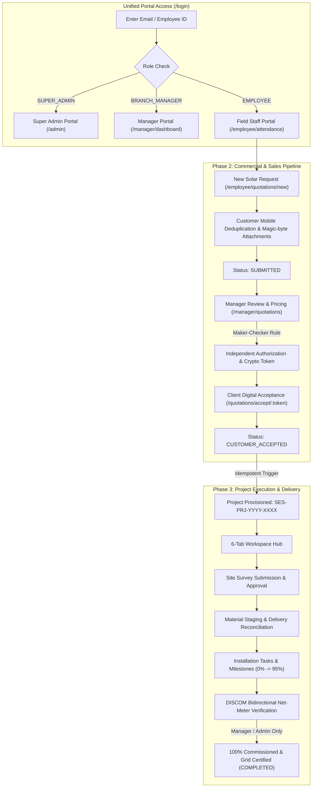

# ☀️ SHIVAY ENERGY SOLUTIONS
> **Tagline:** Save Green Energy To Build A Better Future  
> **Headquarters:** Ward No. 15, In front of PHE Office, Arjun Nagar, Raisen, Madhya Pradesh – 464551, India  
> **Executive Contacts:** Deepak Kushwaha (+91 70005 75496) | Rahul Saini (+91 93997 61750)  
> **Official Email:** shivayenergysolutions@gmail.com  
> **DISCOM Area:** MPPKVVCL (Madhya Kshetra) & Central India  

---

## 📑 Table of Contents
1. [Platform Overview](#-platform-overview)
2. [Shivay Energy Management System (Admin & Operations Portal)](#-shivay-energy-management-system-admin--operations-portal)
   - [Unified Authentication & RBAC Hierarchy](#1-unified-authentication--rbac-hierarchy)
   - [Commercial Engine & Quotation Lifecycle (Phase 2)](#2-commercial-engine--quotation-lifecycle-phase-2)
   - [Project Execution & Site Installation Engine (Phase 3)](#3-project-execution--site-installation-engine-phase-3)
   - [Cloudinary Cloud Storage Architecture (`shivay_energy`)](#4-cloudinary-cloud-storage-architecture-shivay_energy)
   - [System Security Audit & Activity Logs](#5-system-security-audit--activity-logs)
   - [Field Staff GPS Attendance Engine](#6-field-staff-gps-attendance-engine)
3. [End-to-End Workflow Diagram](#-end-to-end-workflow-diagram)
4. [Public Website & Consumer Portals](#-public-website--consumer-portals)
5. [Complete Route & Endpoint Directory](#-complete-route--endpoint-directory)
6. [Architecture & Directory Structure](#-architecture--directory-structure)
7. [Environment Variables Configuration (`.env`)](#-environment-variables-configuration-env)
8. [Automated Verification & Test Suite (100% Pass)](#-automated-verification--test-suite-100-pass)
9. [Running the Application](#-running-the-application)

---

## ⚡ Platform Overview
The **Shivay Energy Solutions Platform** is a full-stack, enterprise-grade Solar Energy Management and Consumer Web System built for rooftop and commercial solar EPC operations across Madhya Pradesh.

The system combines:
1. **Public Consumer Portal**: PM Surya Ghar Muft Bijli Yojana awareness, dynamic subsidy savings calculator, product catalog, customer grievance tracking, and franchise applications.
2. **Shivay Energy Management System (SEMS)**: Comprehensive back-office ERP/CRM covering lead management, quotation drafting, Maker-Checker authorization, digital client acceptance, automated project provisioning, bill of materials tracking, site surveys, magic-byte attachment inspection, Cloudinary asset synchronization, and tamper-evident audit logging.

---

## 🛡️ Shivay Energy Management System (Admin & Operations Portal)



### 1. Unified Authentication & RBAC Hierarchy
- **Single Portal Entry:** All staff roles (Super Admin, Branch Manager, Field Engineer) sign in through a single, unified enterprise sign-in interface at `/login` (aliases: `/admin/login`, `/manager/login`, `/employee/login`).
- **No Public Signup:** Public registration is permanently disabled. New staff members are securely provisioned exclusively by Super Admins through `/admin/employees`.
- **Role Isolation & Boundaries:**
  - **Super Admin (`SUPER_ADMIN`)**: Unrestricted cross-branch oversight, staff onboarding, manager reassignments, financial tax policy configurations, immutable audit trail access (`/admin/activity-logs`), and global quotation/project authorizations.
  - **Branch Manager (`BRANCH_MANAGER` / `MANAGER`)**: Branch-scoped project management, quotation pricing approvals, site visit feasibility clearance, task delegation, and final commissioning certification (`COMPLETED`).
  - **Field Employee (`EMPLOYEE`)**: Geo-tagged attendance check-in, quotation drafting, survey submission, task progress updates, and active milestone updates (`SITE_VISIT_PENDING` to `DISCOM_DOCUMENTATION`).
  - **Strict Security Guardrail:** Field employees are strictly blocked with **HTTP 403 Forbidden** if they attempt to certify final project commissioning (`COMPLETED`) or self-approve quotations they prepared.
- **Smart Login Redirection:**
  - `SUPER_ADMIN` ➔ Redirects to `/admin`
  - `BRANCH_MANAGER` ➔ Redirects to `/manager/dashboard`
  - `EMPLOYEE` ➔ Automatically lands directly on `/employee/attendance` for immediate GPS check-in.
- **Header Profile Architecture:**
  - **Desktop (≥ 768px):** Clean, minimal user profile pill with avatar, name, role badge, and user dropdown menu showing `EMP ID: SES-EMP-...`, profile link, security settings, and logout.
  - **Mobile (< 768px):** Displays only the round profile avatar icon; tapping it routes directly to `/profile` (no clumsy dropdown on mobile).

---

### 2. Commercial Engine & Quotation Lifecycle (Phase 2)
- **Customer CRM & Deduplication:** Field agents search customer mobile numbers (`/api/customers/search?mobile=...`) to auto-fill existing records, preventing duplicate entries.
- **Financial Calculation Engine:**
  - Real-time rooftop solar DC capacity calculation.
  - Standard GST breakdown (12% solar supply or 70:30 EPC deemed civil supply valuation).
  - Central Government Subsidy Deduction (PM Surya Ghar Muft Bijli Yojana): ₹30,000 for 1 kW, ₹60,000 for 2 kW, and ₹78,000 for 3 kW and above.
  - Milestone Payment Terms: 20% Advance, 60% Material delivery at site, 20% Post DISCOM testing & commissioning.
- **Maker-Checker Segregation of Duties:** The staff member who prepares a quotation request cannot authorize or approve it. Formal approval requires independent Manager or Super Admin sign-off.
- **Client Digital Acceptance & WhatsApp Sharing:**
  - Cryptographically unguessable token (`535ba11...`) generated on approval.
  - Public acceptance link (`/quotations/accept/:token`) allows clients to review specs and accept digitally.
  - Managers and Super Admins can also record customer acceptance directly from the portal.
  - Official proposal sharing via WhatsApp with instant PDF letterhead generation and Web Share API attachment support.

---

### 3. Project Execution & Site Installation Engine (Phase 3)
- **Automatic Idempotent Provisioning:** As soon as a quotation transitions to `CUSTOMER_ACCEPTED`, a new Project Work Order (`SES-PRJ-YYYY-XXXX`) is automatically instantiated with technical equipment snapshots.
- **Direct Status Update from Projects List (`/admin/projects`, `/manager/projects`, `/employee/projects`):**
  - Project status column displays a compact status badge accompanied by a circular **Pen Edit Icon Button** (`.status-edit-pen-btn`).
  - Clicking the pen icon opens the **Quick Status Modal** (`#quickStatusModal`), allowing fast milestone updates directly from the listing table without navigating away.
  - The "Workspace" button retains a dedicated, clean outline button style (`padding: 5px 12px; font-size: 12px;`).
- **Interactive 6-Tab Workspace Hub (`/projects/:id`):**
  The workspace navigation features defined, tactile button cards with distinct color themes and contrast badges:
  1. **Overview & Specs:** System capacity (kW), configuration (On-Grid / Off-Grid / Hybrid), customer location, and commercial contract snapshot.
  2. **Site Survey:** Roof dimensioning, tilt angle, shadow analysis, sanction load feasibility, and manager clearance badge (`Pending` / `Review` / `Cleared`).
  3. **Tasks:** Work breakdown structure with assignee tracking, priority tags, and completion timestamps.
  4. **Bill of Materials (BOM):** Solar PV modules, inverters, elevated HDG mounting structures, DC/AC distribution boxes, earthing kits with staged vs delivered quantity reconciliation.
  5. **Documents:** SLD engineering schematics, site photos, DISCOM feasibility letters, and test reports with magic-byte validation and direct Cloudinary CDN links.
  6. **Activity History:** Tamper-evident chronological audit timeline capturing every milestone, status transition, and assignment.
- **Controlled Status Lifecycle & Progress Mapping:**
  - `NOT_STARTED` (0%)
  - `SITE_VISIT_PENDING` (10%)
  - `SITE_VISIT_COMPLETED` (25%)
  - `MATERIAL_PLANNING` (40%)
  - `MATERIAL_READY` (55%)
  - `INSTALLATION_IN_PROGRESS` (70%)
  - `TESTING_AND_COMMISSIONING` (85%)
  - `DISCOM_DOCUMENTATION` (95%)
  - `COMPLETED` (100% - Grid Commissioned & Certified)
  - `ON_HOLD` / `CANCELLED`: Mandatory documented reason required to prevent unauthorized project halts.
- **Final Grid Commissioning Gate:**
  `COMPLETED` status can **only** be certified by Branch Managers or Super Admins and strictly requires the government DISCOM bidirectional net-meter serial number (`meterNumber`).

---

### 4. Cloudinary Cloud Storage Architecture (`shivay_energy`)
All administrative documents, site survey photos, KYC records, and engineering attachments uploaded to the platform are centrally managed through Cloudinary.
- **Target Folder:** All media is stored inside the dedicated **`shivay_energy`** Cloudinary folder.
- **Security & Magic-Byte Pre-Validation:** Before streaming to Cloudinary, files must pass genuine file-signature inspection (JPEG: `FF D8 FF`, PNG: `89 50 4E 47`, PDF: `%PDF`, WEBP: `RIFF...WEBP`). Disguised executables (.exe, .sh, .bat renamed to .jpg) are rejected immediately.
- **Cloud-Only Architecture:** Files are securely streamed directly to Cloudinary without writing any temporary or local files to disk, adhering to production twelve-factor container and serverless filesystem standards.
- **Direct CDN Serving:** Documents in project workspaces and quotation views render direct Cloudinary CDN viewing links.

---

### 5. System Security Audit & Activity Logs
Accessible at `/admin/activity-logs`:
- **Real-Time Security Logging:** Records authentication events, failed logins, unauthorized access attempts, password updates, quotation authorizations, and project status shifts.
- **Executive Metric KPI Cards:**
  - Total Audit Events recorded.
  - Security Alerts & Blocks.
  - Authentication & Session Events.
  - Commercial & Installation Mutations.
- **Dual Display Architecture:**
  - **Desktop (≥ 992px):** Comprehensive audit table with IST timestamp (Date + Time), severity-coded action badges, user profiles with role badges, origin IP, and structured payload chips.
  - **Mobile (< 992px):** SaaS-style vertical audit card stack with zero horizontal overflow, actor initial avatars, and an "Inspect" button.
- **Search & Filter Bar:**
  - Pixel-perfect 38px unified height across search icon, input field, instant clear `(X)` button, and filter button.
  - Live typing search across actor name, email, employee ID, action type, IP address, and JSON details payload.
  - One-click category filter pills (`All Logs`, `Security`, `Auth`, `Commercial`, `Field`).
- **Payload Inspector Modal:** Clickable modal providing syntax-highlighted JSON view with a "Copy to Clipboard" shortcut.

---

### 6. Field Staff GPS Attendance Engine
- **Geo-Tagged Punch In/Out:** Field technicians punch attendance from `/employee/attendance` with GPS latitude, longitude, and device accuracy.
- **Anti-Spoofing Identity Lock:** The attendance submission identity is derived strictly from the verified HTTP session (`req.session.user`). Any attempt to alter or spoof employee IDs in the request body is rejected.
- **Duplicate Prevention:** Single punch-in per calendar day enforced; check-out requires prior check-in.

---

## 🌐 End-to-End Workflow Diagram

| Step | Stage | Primary Role | Action / Milestone | Resulting Status |
|:---:|:---|:---|:---|:---|
| **1** | Staff Onboarding | Super Admin | Creates staff profile via `/admin/employees` | User record created (`SES-EMP-XX`) |
| **2** | Daily Sign In | Field Engineer | Logs in at `/login` ➔ Lands on `/employee/attendance` | Geo-tagged check-in recorded |
| **3** | Lead Capture | Field Engineer | Enters customer profile & solar specs at `/employee/quotations/new` | Request created (`SUBMITTED`) |
| **4** | Technical Review | Branch Manager | Inspects specs, applies discounts & checks feasibility at `/manager/quotations` | Quotation authorized (`APPROVED`) |
| **5** | Customer Acceptance | Client / Manager | Accepts proposal via `/quotations/accept/:token` or direct confirmation | Quotation marked (`CUSTOMER_ACCEPTED`) |
| **6** | Work Order Creation | Automation Engine | Idempotently provisions Project Work Order | Project created (`SES-PRJ-YYYY-XXXX`) |
| **7** | Site Survey | Field Engineer | Submits roof dimensions, tilt angle & photos to Cloudinary | Survey status: `SUBMITTED` |
| **8** | Survey Clearance | Branch Manager | Approves survey observations in workspace | Project advances to 25% |
| **9** | Material Delivery | Field Team | Stages & marks delivery of panels, inverter, mounting kits | Status: `MATERIAL_READY` (55%) |
| **10** | Physical Installation | Field Engineers | Executes electrical BoS, earthing, module stringing & DCDB wiring | Status: `INSTALLATION_IN_PROGRESS` (70%) |
| **11** | DISCOM Liaisoning | Manager / Staff | Submits Net-Metering application to MPPKVVCL | Status: `DISCOM_DOCUMENTATION` (95%) |
| **12** | Grid Commissioning | Branch Manager | Inspects bidirectional net-meter & certifies completion | **`COMPLETED` (100% Certified)** |

---

## 💻 Public Website & Consumer Portals
- **Homepage (`/`):** Showcase of residential, commercial, and agricultural solar rooftop projects with Solaria UI tokens (`#c6ff7d` / `#163563`).
- **PM Surya Ghar Subsidy Guide (`/#govt-scheme-section`):** Comprehensive breakdown of central subsidy slabs under PM Surya Ghar Muft Bijli Yojana.
- **Interactive Solar Savings Calculator (`/calculator`):** Computes recommended plant capacity (kW), monthly unit generation, annual savings in ₹, central subsidy deductions, and estimated payback period.
- **Customer Grievance & Complaint Tracker (`/complaints`):** Online complaint submission for solar inverter or plant generation issues with automated tracking ID (`SHIVAY-XXXXX`).
- **Dealership & Franchise Portal (`/franchise`):** District-wise dealership application across Madhya Pradesh with direct WhatsApp lead routing.

---

## 🗺️ Complete Route & Endpoint Directory

### Authentication & Sessions
| Method | Route | Access | Description |
|---|---|---|---|
| `GET` | `/login` | Public | Unified sign-in portal |
| `POST` | `/login` | Public | Authenticates credentials with 15-minute brute-force lock |
| `GET` / `POST` | `/logout` | Authenticated | Destroys server session & clears cookies |

### Super Admin Operations (`/admin`)
| Method | Route | Access | Description |
|---|---|---|---|
| `GET` | `/admin` | Super Admin | Executive KPI dashboard & revenue metrics |
| `GET` | `/admin/projects` | Super Admin | Global project oversight with quick status update modal |
| `GET` | `/admin/quotations` | Super Admin | Cross-branch quotation list with PDF export |
| `GET` | `/admin/invoices` | Super Admin | Tax invoices repository & GST snapshots |
| `GET` | `/admin/employees` | Super Admin | Staff onboarding & role delegation |
| `GET` | `/admin/activity-logs`| Super Admin | Immutable audit trail & security activity logs |
| `GET` | `/admin/profile` | Super Admin | Admin account settings & password modification |

### Branch Manager Operations (`/manager`)
| Method | Route | Access | Description |
|---|---|---|---|
| `GET` | `/manager/dashboard` | Branch Manager | Branch-specific active installations & KPI metrics |
| `GET` | `/manager/projects` | Branch Manager | Branch projects list with inline status update pen button |
| `GET` | `/manager/projects/:id`| Branch Manager | Full project workspace hub (6 Tabs) |
| `GET` | `/manager/quotations`| Branch Manager | Quotation approval desk (Maker-Checker enforced) |
| `GET` | `/manager/quotations/request/:id` | Branch Manager | Detailed technical review & pricing formulation |
| `POST`| `/manager/quotations/request/:id/approve` | Branch Manager | Authorizes quote & generates client acceptance token |
| `POST`| `/manager/projects/:id/complete` | Branch Manager | Final commissioning certification with DISCOM meter # |

### Field Staff & Employee Portal (`/employee`)
| Method | Route | Access | Description |
|---|---|---|---|
| `GET` | `/employee/attendance` | Employee | GPS geo-tagged mobile attendance check-in/out |
| `POST`| `/api/attendance` | Employee | Submits authenticated coordinates (session-verified) |
| `GET` | `/employee/projects` | Employee | Assigned projects list with inline status update pen button |
| `GET` | `/employee/projects/:id` | Employee | Assigned project workspace hub |
| `POST`| `/employee/projects/:id/status` | Employee | Updates active milestone status (HTTP 403 on `COMPLETED`) |
| `GET` | `/employee/quotations` | Employee | Field quotation requests desk |
| `GET` | `/employee/quotations/new` | Employee | Customer technical premise entry & file attachments |
| `POST`| `/employee/quotations/new` | Employee | Creates quotation request with magic-byte validation |
| `GET` | `/employee/profile` | Employee | Staff profile & password management |

### Shared Cloud Storage & Document Endpoints
| Method | Route | Access | Description |
|---|---|---|---|
| `POST`| `/private/projects/:id/documents` | Authenticated | Uploads project document to Cloudinary `shivay_energy` folder |
| `GET` | `/private/projects/:id/documents/:docId` | Authenticated | Streams/redirects to secure Cloudinary asset |
| `GET` | `/attachments/:filename` | Authenticated | Accesses supporting quotation KYC attachments |

---

## 📂 Architecture & Directory Structure
```
solar_panial/
├── config/
│   ├── cloudinary.js          # Cloudinary SDK configuration (shivay_energy folder)
│   ├── company.js             # Master business profile, contacts, bank details, DISCOM info
│   └── database.js            # MongoDB Mongoose connection with in-memory fallback
├── controllers/
│   ├── adminController.js     # Super admin dashboard, staff onboarding, activity logs
│   ├── authController.js      # Unified login, authentication, logout, session security
│   ├── customerController.js  # Customer CRM and mobile search deduplication
│   ├── employeeController.js  # Field staff workspace, profile, GPS attendance
│   ├── managerController.js   # Branch manager operations, attendance logs, approvals
│   ├── projectController.js   # Project workspace, task updates, BOM, Cloudinary docs
│   └── quotationController.js # Quotation drafting, Maker-Checker authorization, acceptance
├── middleware/
│   └── authMiddleware.js      # RBAC guards (requireSuperAdmin, requireBranchManager, requireEmployee)
├── models/
│   ├── AuditLog.js            # Immutable system audit records & security event logs
│   ├── Customer.js            # CRM client database with consumer number & DISCOM indexing
│   ├── Invoice.js             # GST tax invoice model with statutory itemization
│   ├── Project.js             # Project execution model with BOM, tasks, survey & Cloudinary docs
│   ├── ProjectActivity.js     # Chronological append-only project installation timeline
│   ├── Quotation.js           # Commercial quotation model with subsidy & payment milestones
│   ├── QuotationRequest.js    # Field requests with equipment rows & Cloudinary attachments
│   └── User.js                # Enterprise user schema (SUPER_ADMIN, MANAGER, EMPLOYEE)
├── routes/
│   ├── publicroute/
│   │   └── publicroutes.js        # Public website pages, enquiries, complaints & token customer acceptance
│   ├── privateroute/
│   │   ├── authroutes.js          # Unified sign-in, login rate limiters, session destruction & password changes
│   │   ├── superadminroutes.js    # Super Admin operations, user management, Maker-Checker & grid commissioning
│   │   ├── managerroutes.js       # Branch Manager review, survey approvals, stage reviews & team attendance
│   │   └── employeeroutes.js      # Field Engineer requests, site surveys, task logging & GPS attendance
│   └── webRoutes.js               # Central aggregator mounting public & private route bundles
├── services/
│   ├── auditService.js        # Audit logging service for security & mutation events
│   ├── projectService.js      # Project lifecycle, milestone validation & commissioning rules
│   ├── quotationService.js    # Commercial calculation, GST snapshot & subsidy logic
│   └── uploadService.js       # Magic-byte file validation & Cloudinary stream pipeline
├── tests/
│   ├── security.test.js       # 20 RBAC, route boundary, CSRF & crypto tests
│   ├── phase1.test.js         # 31 Database foundation, session & middleware tests
│   ├── phase2.test.js         # 35 Commercial engine, Maker-Checker & token tests
│   └── phase3.test.js         # 20 Project execution, site survey & net-metering tests
├── views/
│   ├── private/               # Authenticated enterprise management views
│   │   ├── admin/             # Super admin views (dashboard, activity logs, profile, staff)
│   │   ├── manager/           # Branch manager views (dashboard, quotation review, workspace)
│   │   ├── employee/          # Field engineer views (attendance, quotation request, workspace)
│   │   ├── projects/          # Unified project listing & 6-tab workspace detail views
│   │   └── auth/              # Unified enterprise sign-in interface
│   └── public-site/           # Public website, solar calculator, complaints & franchise
├── .env                       # Environment credentials & Cloudinary API secrets
├── .env.example               # Environment variables template
├── package.json               # Node.js dependencies & scripts
└── server.js                  # Application bootstrap & Express server entry point
```

---

## 🔑 Environment Variables Configuration (`.env`)
Create a `.env` file in the root directory:
```env
# Application Server
PORT=3000
NODE_ENV=development

# Session Cryptography
SESSION_SECRET=ses_super_secure_enterprise_session_secret_key_2026

# Database Connection
MONGO_URI=mongodb://localhost:27017/shivay_energy

# Enterprise Notification & Contacts
ADMIN_EMAIL=shivayenergysolutions@gmail.com
COMPANY_PHONE_1=+917000575496
COMPANY_PHONE_2=+919399761750

# Cloudinary Enterprise Cloud Storage
CLOUDINARY_CLOUD_NAME=your_cloud_name
CLOUDINARY_API_KEY=your_api_key
CLOUDINARY_API_SECRET=your_api_secret
```

---

## 🧪 Automated Verification & Test Suite (100% Pass)
The application includes automated integration test suites validating security, commercial governance, and project execution:

```bash
# Run Security & RBAC Suite (20 Scenarios)
node tests/security.test.js

# Run Phase 1 Foundation Suite (31 Scenarios)
node tests/phase1.test.js

# Run Phase 2 Commercial Engine Suite (35 Scenarios)
node tests/phase2.test.js

# Run Phase 3 Project Execution Suite (20 Scenarios)
node tests/phase3.test.js
```

### Test Suite Summary:
- **`tests/security.test.js`**: **20 / 20 PASS (100%)**
  - Route boundary protection, session invalidation on logout, unauthorized role attempt blocking, financial document creation restrictions, multi-branch isolation, session-derived GPS attendance verification, missing CSRF token rejection, bcrypt password hashing, and brute-force account locking.
- **`tests/phase1.test.js`**: **31 / 31 PASS (100%)**
  - Mongoose models, session lifecycle, role middleware enforcement, branch manager scoping, employee portal routing directly to attendance, and placeholder views.
- **`tests/phase2.test.js`**: **35 / 35 PASS (100%)**
  - Commercial calculations, PM Surya Ghar subsidy deductions (up to ₹78,000), milestone payment allocation, customer mobile deduplication, magic-byte validation (blocking disguised executables), quotation request versioning, Maker-Checker segregation of duties, and unguessable customer acceptance tokens.
- **`tests/phase3.test.js`**: **20 / 20 PASS (100%)**
  - Idempotent project creation from accepted quotations, branch isolation, employee milestone updates, mandatory reasons for `ON_HOLD`/`CANCELLED`, site survey approvals, engineering task permissions, BOM staging/delivery reconciliation, and final commissioning gate requiring bidirectional net-meter numbers.
- **Total:** **106 / 106 Tests Passed (100%)**

---

## 🚀 Running the Application

### 1. Install Dependencies
```bash
npm install
```

### 2. Start Application
```bash
# Production start
npm start

# Development watch mode
npm run dev
```

### 3. Access Portals
- **Public Website:** `http://localhost:3000`
- **Solar Calculator:** `http://localhost:3000/calculator`
- **PM Surya Ghar Scheme:** `http://localhost:3000/#govt-scheme-section`
- **Customer Grievances:** `http://localhost:3000/complaints`
- **Enterprise Management Portal (Login):** `http://localhost:3000/login`
- **Super Admin Dashboard:** `http://localhost:3000/admin`
- **System Activity & Audit Logs:** `http://localhost:3000/admin/activity-logs`
- **Branch Manager Projects Hub:** `http://localhost:3000/manager/projects`
- **Field Engineer Attendance:** `http://localhost:3000/employee/attendance`
- **New Quotation Request:** `http://localhost:3000/employee/quotations/new`

---
*Built with ❤️ for Shivay Energy Solutions — Accelerating Solar Adoption Across Central India.*
